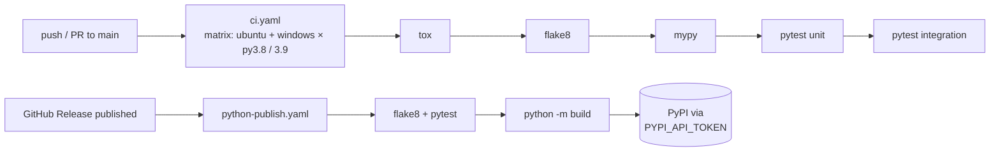

<div align="center">

# 🍃 mongo-connect

### A pip-installable MongoDB helper with a production-style Python packaging and CI/CD setup

*One class for connecting, choosing a database and collection, and inserting records or whole CSV/Excel files.*

<br/>


</div>

---

## 💡 Why

Every data project that uses MongoDB starts with the same boilerplate: build a client, pick a database, pick a collection, insert records, and load a dataframe. `mongo-connect` puts that in one importable class.

The project is also a **reference setup for packaging Python code properly**: `src/` layout, `setup.py` + `setup.cfg` + `pyproject.toml`, tox, linting, type checking, and a GitHub Actions pipeline that **publishes to PyPI when you create a GitHub release**.

---

## ✨ Usage

```python
from mongodb_connect.mongo_crud import mongo_operation

mongo = mongo_operation(
    client_url="mongodb+srv://<user>:<password>@cluster0.mongodb.net/",
    database_name="analytics",
    collection_name="customers",
)

# one record or many: dicts are type-checked before insert
mongo.insert_record({"name": "Ada", "plan": "pro"}, collection_name="customers")
mongo.insert_record([{"name": "Alan"}, {"name": "Grace"}], collection_name="customers")

# whole file → collection (CSV or Excel → DataFrame → JSON records)
mongo.bulk_insert("customers.csv", collection_name="customers")
```

| Method | What it does |
|---|---|
| `create_mongo_client()` | Builds a `pymongo.MongoClient` from the connection URL |
| `create_database()` | Returns the database handle and reuses it on later calls |
| `create_collection(name)` | Returns the collection handle and switches when the name changes |
| `insert_record(record, collection_name)` | `insert_one` for a dict, `insert_many` for a list of dicts, `TypeError` for anything else |
| `bulk_insert(path, collection_name)` | Loads `.csv` / `.xlsx` with pandas and inserts every row |

---

## 🏗️ Engineering setup



- **`src/` layout**, so tests run against the installed package and not the working directory
- **`tox`** runs lint, type checks and both test suites against Python 3.7–3.9
- **CI on a 2-OS × 2-Python matrix** for every push and PR. README-only changes are skipped through `paths-ignore`.
- **Release-driven publishing.** Creating a GitHub release builds the sdist and wheel and uploads them to PyPI with a repository secret.
- **`requirements_dev.txt`** pins pytest, tox, black, flake8 and mypy
- **`template.py`** scaffolds the whole layout in one command

---

## 🚀 Develop locally

```bash
git clone https://github.com/nishantrv/MongoDB-Connector-Pkg.git
cd MongoDB-Connector-Pkg
python -m venv .venv && source .venv/bin/activate
pip install -r requirements_dev.txt      # installs the package in editable mode (-e .)
tox                                      # lint + type-check + tests
```

---

## 🗂️ Layout

```
src/mongodb_connect/mongo_crud.py    the mongo_operation class
tests/unit · tests/integration       pytest suites
.github/workflows/ci.yaml            matrix CI via tox
.github/workflows/python-publish.yaml  build + publish on release
setup.py · setup.cfg · pyproject.toml · tox.ini
```

---

<div align="center">

Built by **[Nishant](https://github.com/nishantrv)** · MIT licensed

</div>
